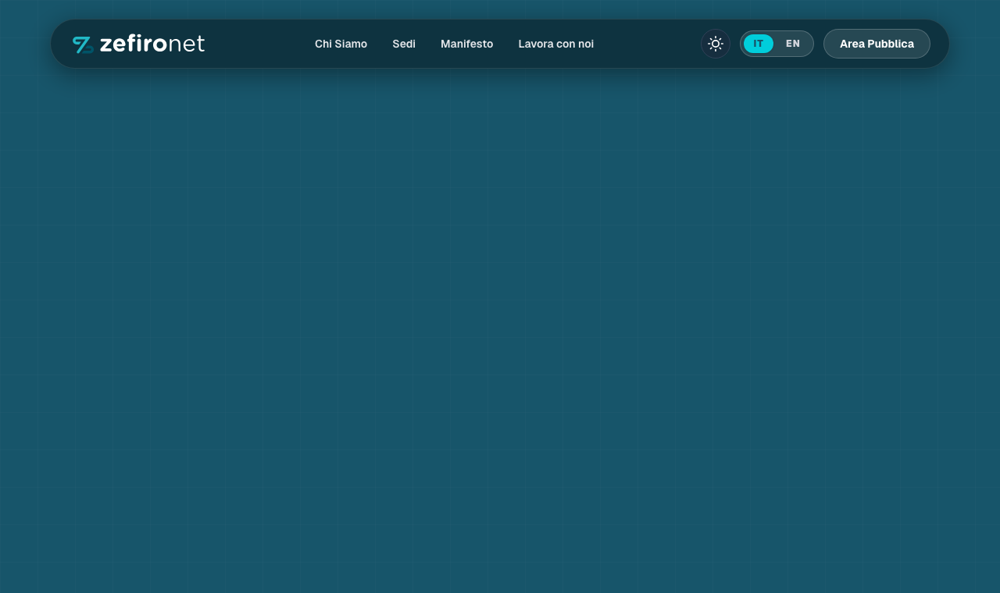
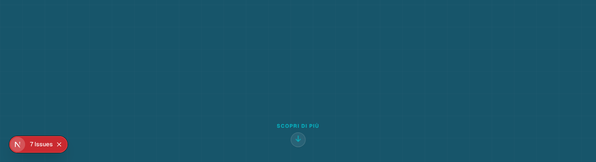

# 📄 Modulo Raccolta e Revisione Contenuti — Zefiro Net Website
> **Destinatario:** Team HR & Comunicazione / Direzione Zefiro Net  
> **Oggetto:** Inserimento e approvazione testi per il nuovo sito web istituzionale (Italiano 🇮🇹 / Inglese 🇬🇧).  
> **Istruzioni:** Ciascuna sezione presenta lo **screenshot visivo della schermata aggiornata** e i campi da compilare `[ NUOVO TESTO IT ]` e `[ NUOVO TESTO EN ]`. Se un testo attuale è già approvato, è sufficiente scrivere **"CONFERMATO"**.

---

## 📌 Indice delle Sezioni
1. [Header & Menu di Navigazione](#1-header--menu-di-navigazione)
2. [Homepage (Hero Banner, Mappa di Copertura, Metriche, Highlights)](#2-homepage)
3. [Pagina: Chi Siamo (La Joint Venture, Missione, Wholesale, Soci, Certificazioni)](#3-pagina-chi-siamo)
4. [Pagina: Sedi (Milano & Roma)](#4-pagina-sedi)
5. [Pagina: Manifesto (I 5 Valori Cardine)](#5-pagina-manifesto)
6. [Pagina: Lavora con Noi (Valori People, Candidatura Spontanea)](#6-pagina-lavora-con-noi)
7. [Pagina: Documenti Pubblici (Bilanci, Governance, Sicurezza)](#7-pagina-documenti-pubblici)
8. [Footer & Informazioni Societarie](#8-footer--informazioni-societarie)

---

## 1. Header & Menu di Navigazione
*La barra di navigazione visibile in cima a tutte le pagine del sito.*

| Voce Menu | Testo Attuale (IT) | NUOVO TESTO IT (da compilare) | Testo Attuale (EN) | NUOVO TESTO EN (da compilare) |
| :--- | :--- | :--- | :--- | :--- |
| Voce 1 | Chi Siamo | | About Us | |
| Voce 2 | Sedi | | Offices | |
| Voce 3 | Manifesto | | Manifesto | |
| Voce 4 | Lavora con noi | | Work with us | |
| Voce 5 | Area Pubblica (Documenti) | | Public Area | |

---

## 2. Homepage

### 2.1 Hero Banner Principale (A tutto schermo)
*Il primo impatto visivo del sito con l'antenna 3D interattiva.*

- **Titolo Principale (Claim):**
  - *Attuale IT:* `Connettere in un soffio.`
  - **[ NUOVO TESTO IT ]: **
  - *Attuale EN:* `Connecting in a breath.`
  - **[ NUOVO TESTO EN ]: **

- **Sottotitolo / Descrizione:**
  - *Attuale IT:* `Acceleriamo lo sviluppo delle reti 5G in Italia. Forniamo infrastrutture wholesale d'eccellenza per connettere le aree rurali e colmare il digital divide.`
  - **[ NUOVO TESTO IT ]: **
  - *Attuale EN:* `We accelerate the deployment of 5G networks across Italy. Providing world-class wholesale infrastructure to connect rural areas and bridge the digital divide.`
  - **[ NUOVO TESTO EN ]: **

- **Pulsante CTA Primario (Azzurro):**
  - *Attuale IT:* `Il progetto Zefiro` (porta a Chi Siamo)
  - **[ NUOVO TESTO IT ]: **
  - *Attuale EN:* `The Zefiro Project`
  - **[ NUOVO TESTO EN ]: **

- **Pulsante CTA Secondario (Trasparente con bordo bianco):**
  - *Attuale IT:* `Il nostro Manifesto` (porta al Manifesto)
  - **[ NUOVO TESTO IT ]: **
  - *Attuale EN:* `Our Manifesto`
  - **[ NUOVO TESTO EN ]: **

---

### 2.2 Sezione Mappa & Copertura Nazionale
*La sezione con la mappa interattiva d'Italia e i dati di copertura.*

- **Badge superiore (Etichetta):**
  - *Attuale IT:* `Infrastruttura & Territorio`
  - **[ NUOVO TESTO IT ]: **
  - *Attuale EN:* `Infrastructure & Territory`
  - **[ NUOVO TESTO EN ]: **

- **Titolo Sezione:**
  - *Attuale IT:* `Connettiamo il 70% del territorio italiano`
  - **[ NUOVO TESTO IT ]: **
  - *Attuale EN:* `Connecting 70% of Italian Territory`
  - **[ NUOVO TESTO EN ]: **

- **Testo Descrittivo:**
  - *Attuale IT:* `Superiamo il digital divide portando la tecnologia 5G e le reti ultra-broadband nel 70% del territorio nazionale, principalmente nelle aree rurali e meno densamente popolate del Paese. Con circa 7.000 siti e torri radiomobili attive, abilitiamo un'infrastruttura wholesale d'eccellenza aperta e condivisa.`
  - **[ NUOVO TESTO IT ]: **
  - *Attuale EN:* `Bridging the digital divide by delivering 5G and ultra-broadband networks across 70% of the national territory, mainly in rural and sparsely populated areas. With around 7,000 active mobile sites and towers, we enable an open, shared wholesale infrastructure of excellence.`
  - **[ NUOVO TESTO EN ]: **

- **Le 3 Metriche Chiave (Statistiche):**
  1. **Statistica 1:**
     - *Valore Attuale:* `70%` | *Label IT:* `Territorio nazionale coperto (zone rurali)` | *Label EN:* `National territory covered (rural areas)`
     - **[ NUOVO VALORE ]: **
     - **[ NUOVA LABEL IT ]: **
     - **[ NUOVA LABEL EN ]: **
  2. **Statistica 2:**
     - *Valore Attuale:* `~7.000` | *Label IT:* `Siti e torri radiomobili attive` | *Label EN:* `Active mobile towers & sites`
     - **[ NUOVO VALORE ]: **
     - **[ NUOVA LABEL IT ]: **
     - **[ NUOVA LABEL EN ]: **
  3. **Statistica 3:**
     - *Valore Attuale:* `100%` | *Label IT:* `Wholesale-Only condiviso` | *Label EN:* `Shared Wholesale-Only`
     - **[ NUOVO VALORE ]: **
     - **[ NUOVA LABEL IT ]: **
     - **[ NUOVA LABEL EN ]: **

---

### 2.3 Sezione Valori & Punti di Forza (Highlights)
*Le 3 schede interattive 3D sotto la mappa.*

- **Titolo Sezione:**
  - *Attuale IT:* `Una missione condivisa — Eccellenza tecnologica al servizio degli operatori`
  - **[ NUOVO TESTO IT ]: **
  - *Attuale EN:* `A shared mission — Technological excellence serving telecom operators`
  - **[ NUOVO TESTO EN ]: **

- **Scheda 1 (Icona Segnale/5G):**
  - *Titolo IT:* `Copertura 5G Capillare` | *Titolo EN:* `Widespread 5G Coverage`
  - **[ NUOVO TITOLO IT / EN ]: **
  - *Descrizione IT:* `Infrastrutture radiomobili avanzate per abilitare la connettività ultra-broadband nelle aree rurali e a fallimento di mercato.`
  - *Descrizione EN:* `Advanced mobile infrastructure enabling ultra-broadband connectivity across rural and market-failure regions.`
  - **[ NUOVA DESCRIZIONE IT / EN ]: **

- **Scheda 2 (Icona Rete Wholesale):**
  - *Titolo IT:* `Modello Wholesale Condiviso` | *Titolo EN:* `Shared Wholesale Model`
  - **[ NUOVO TITOLO IT / EN ]: **
  - *Descrizione IT:* `Condivisione efficiente della rete di accesso tra operatori per ottimizzare gli investimenti e ridurre l'impatto ambientale.`
  - *Descrizione EN:* `Efficient access network sharing between operators to optimize investments and minimize environmental impact.`
  - **[ NUOVA DESCRIZIONE IT / EN ]: **

- **Scheda 3 (Icona Scudo/Resilienza):**
  - *Titolo IT:* `Affidabilità e Resilienza` | *Titolo EN:* `Reliability & Resilience`
  - **[ NUOVO TITOLO IT / EN ]: **
  - *Descrizione IT:* `Controllo e monitoraggio continuativo 24/7 per garantire la massima continuità operativa e tempi di intervento immediati.`
  - *Descrizione EN:* `Continuous 24/7 monitoring and control to guarantee maximum operational continuity and rapid response times.`
  - **[ NUOVA DESCRIZIONE IT / EN ]: **

---

## 3. Pagina: Chi Siamo

- **Intestazione & Sottotitolo:**
  - *Titolo IT:* `Chi siamo` | *Titolo EN:* `About us`
  - *Sottotitolo IT:* `Zefiro Net SRL è la joint venture paritetica creata da <strong>WINDTRE</strong> e <strong>Iliad Italia</strong>, nata per gestire e sviluppare congiuntamente la rete di telefonia mobile nelle aree meno densamente popolate d'Italia.`
  - **[ NUOVO SOTTOTITOLO IT ]: **
  - *Sottotitolo EN:* `Zefiro Net SRL is the 50/50 joint venture created by <strong>WINDTRE</strong> and <strong>Iliad Italia</strong>, established to jointly manage and expand mobile networks in Italy's less densely populated areas.`
  - **[ NUOVO SOTTOTITOLO EN ]: **

- **Blocco 1: La Nostra Missione:**
  - *Titolo IT:* `La nostra missione` | *Titolo EN:* `Our Mission`
  - **[ NUOVO TITOLO IT / EN ]: **
  - *Testo IT:* `La nostra missione è abbattere il digital divide, garantendo a tutto il territorio nazionale l'accesso a reti di telecomunicazione moderne e performanti. Attraverso la condivisione delle infrastrutture (RAN sharing), ottimizziamo gli investimenti e acceleriamo la copertura delle aree rurali e suburbane con le più recenti tecnologie, a partire dal <strong>5G</strong>.`
  - **[ NUOVO TESTO IT / EN ]: **

- **Blocco 2: Operatore Wholesale B2B:**
  - *Titolo IT:* `Operatore Wholesale B2B` | *Titolo EN:* `B2B Wholesale Provider`
  - **[ NUOVO TITOLO IT / EN ]: **
  - *Testo IT:* `Zefiro Net opera esclusivamente come fornitore di infrastrutture all'ingrosso (wholesale) per i propri soci. Non forniamo servizi di connettività B2C diretti al pubblico, ma garantiamo che gli operatori partner possano offrire il miglior servizio possibile ai propri clienti, poggiandosi su un'infrastruttura resiliente, sicura e all'avanguardia tecnologica.`
  - **[ NUOVO TESTO IT / EN ]: **

- **I Nostri Soci (Shareholders):**
  1. **WINDTRE (50%):**
     - *Descrizione IT:* `Socio al 50%, porta nella joint venture la solidità e la capillarità di uno dei principali operatori italiani.`
     - **[ NUOVA DESCRIZIONE IT / EN ]: **
  2. **Iliad Italia (50%):**
     - *Descrizione IT:* `Socio al 50%, contribuisce con la spinta innovativa che ha rivoluzionato il mercato mobile in Italia.`
     - **[ NUOVA DESCRIZIONE IT / EN ]: **

- **Certificazioni & Conformità:**
  1. **Rating ESG:**
     - *Descrizione IT:* `Zefiro Net si impegna a integrare criteri ambientali, sociali e di governance (ESG) in tutti i processi decisionali e operativi.`
     - **[ NUOVO TESTO IT / EN ]: **
  2. **Modello 231:**
     - *Descrizione IT:* `Abbiamo adottato un Modello di Organizzazione, Gestione e Controllo ai sensi del D.Lgs. 231/01 per prevenire la commissione di reati.`
     - **[ NUOVO TESTO IT / EN ]: **
  3. **Certificazione ISO 9001:**
     - *Descrizione IT:* `Il nostro Sistema di Gestione per la Qualità è certificato ISO 9001, garantendo standard eccellenti in ogni fase delle nostre attività.`
     - **[ NUOVO TESTO IT / EN ]: **

---

## 4. Pagina: Sedi

- **Sede di Milano (Il Pharo - Sede Legale & Direzionale):**
  - *Tipologia:* `Sede Legale e Operativa` | `Registered & Operational HQ`
  - *Indirizzo:* `Via Gattamelata, 34 — 20149 Milano (MI)`
  - *Email:* `amministrazione@zefironet.it`
  - *Descrizione IT:* `Sede legale principale e centro direzionale e operativo di Zefiro Net.`
  - **[ EVENTUALI MODIFICHE INDIRIZZO / EMAIL / TESTO ]: **

- **Sede di Roma (Polo Operativo):**
  - *Tipologia:* `Sede Operativa` | `Operations Hub`
  - *Indirizzo:* `Via Luca Gaurico, 9/11 — 00143 Roma (RM)`
  - *Email:* `info@zefironet.it`
  - *Descrizione IT:* `Ufficio operativo e polo di coordinamento di Zefiro Net a Roma.`
  - **[ EVENTUALI MODIFICHE INDIRIZZO / EMAIL / TESTO ]: **

---

## 5. Pagina: Manifesto (I Nostri Valori)

- **Sottotitolo Pagina:**
  - *Attuale IT:* `Crediamo in un'Italia connessa, senza distinzioni geografiche. Lavoriamo dietro le quinte affinché la digitalizzazione diventi una realtà concreta per tutti.`
  - *Attuale EN:* `We believe in a seamlessly connected Italy without geographical disparities. We work behind the scenes to make digitization a tangible reality for everyone.`
  - **[ NUOVO TESTO IT / EN ]: **

- **Valore 1: Inclusione Digitale**
  - *Descrizione IT:* `Le aree meno densamente popolate meritano le stesse opportunità dei grandi centri urbani. La nostra infrastruttura è la base su cui si costruisce l'inclusione digitale del Paese.`
  - **[ NUOVO TESTO IT / EN ]: **

- **Valore 2: Sostenibilità e Condivisione**
  - *Descrizione IT:* `Il modello della joint venture e del RAN sharing riduce l'impatto ambientale e paesaggistico. Costruiamo una rete unica per più operatori, ottimizzando risorse e limitando la proliferazione di antenne.`
  - **[ NUOVO TESTO IT / EN ]: **

- **Valore 3: Eccellenza B2B**
  - *Descrizione IT:* `Come operatore wholesale, la nostra responsabilità è verso i nostri soci e, indirettamente, verso i loro clienti. Garantiamo i massimi standard di affidabilità, sicurezza informativa e innovazione tecnologica.`
  - **[ NUOVO TESTO IT / EN ]: **

- **Valore 4: Innovazione Responsabile**
  - *Descrizione IT:* `Sperimentiamo tecnologie all'avanguardia come il 5G con l'obiettivo di migliorare la vita delle persone, rispettando sempre i più alti standard di sicurezza e privacy.`
  - **[ NUOVO TESTO IT / EN ]: **

- **Valore 5: Integrità e Trasparenza**
  - *Descrizione IT:* `Operiamo con la massima onestà e chiarezza nei confronti dei nostri soci, dei partner e della collettività, promuovendo una governance solida e affidabile.`
  - **[ NUOVO TESTO IT / EN ]: **

---

## 6. Pagina: Lavora con Noi (Sezione HR)

- **Intestazione & Sottotitolo:**
  - *Titolo IT:* `Lavora con noi` | *Titolo EN:* `Work with us`
  - *Sottotitolo IT:* `Entra a far parte della joint venture che sta accelerando il futuro digitale dell'Italia. Cerchiamo talenti pronti a fare la differenza.`
  - **[ NUOVO SOTTOTITOLO IT / EN ]: **

- **I 3 Valori del Team (Pillars People):**
  1. **Innovazione Continua:**
     - *Descrizione IT:* `Sperimentiamo le tecnologie 5G più avanzate per connettere anche le aree più remote d'Italia.`
     - **[ NUOVO TESTO IT / EN ]: **
  2. **Sostenibilità:**
     - *Descrizione IT:* `Costruiamo infrastrutture nel rispetto dell'ambiente e del territorio, promuovendo uno sviluppo equo.`
     - **[ NUOVO TESTO IT / EN ]: **
  3. **Eccellenza Tecnica:**
     - *Descrizione IT:* `Il nostro team è composto dai migliori esperti nel settore delle telecomunicazioni wholesale.`
     - **[ NUOVO TESTO IT / EN ]: **

- **Box Candidatura Spontanea:**
  - *Titolo:* `Candidatura Spontanea` | `Open Application`
  - *Descrizione IT:* `Inviaci il tuo CV e raccontaci come puoi contribuire al progetto Zefiro Net.`
  - **[ NUOVA DESCRIZIONE IT / EN ]: **
  - *Email di ricezione CV:* `candidatura@zefironet.it`
  - **[ EMAIL DESTINATARIA DEFINITIVA ]: **

---

## 7. Pagina: Documenti Pubblici

*Indicare i documenti societari ufficiali (PDF) da caricare e pubblicare sul sito:*

| N° | Titolo Documento IT | Titolo Documento EN | Categoria (Finanza / Governance / Sicurezza) | Nome File PDF da allegare |
| :--- | :--- | :--- | :--- | :--- |
| 1 | Bilancio d'Esercizio 2024 | Annual Financial Report 2024 | Finanza | `bilancio-2024.pdf` |
| 2 | Bilancio d'Esercizio 2023 | Annual Financial Report 2023 | Finanza | `bilancio-2023.pdf` |
| 3 | Relazione sul Governo Societario | Corporate Governance Report | Governance | `governance-report.pdf` |
| 4 | Codice Etico e di Condotta | Code of Ethics | Governance | `codice-etico.pdf` |
| 5 | Politica per la Sicurezza delle Informazioni | Information Security Policy | Sicurezza | `sicurezza-info.pdf` |
| 6 | *[ Nuovo Documento ]* | | | |

---

## 8. Footer & Dati Legali

- **Tagline:** `Connettere in un soffio.` / `Connecting in a breath.`
- **Dati Societari:**
  - *Ragione Sociale:* `Zefiro Net S.r.l.`
  - *Sede Legale:* `Milano, Via Gattamelata, 34 (Il Pharo)`
  - *Link Whistleblowing / Modello 231 / Privacy / Cookie:* *(Confermare o indicare link specifici)*
  - **[ NOTE O INTEGRAZIONI DATI SOCIETARI / P.IVA / CAP. SOC. ]: **

---
*Modulo generato per il team Zefiro Net con screenshot visivi aggiornati.*
