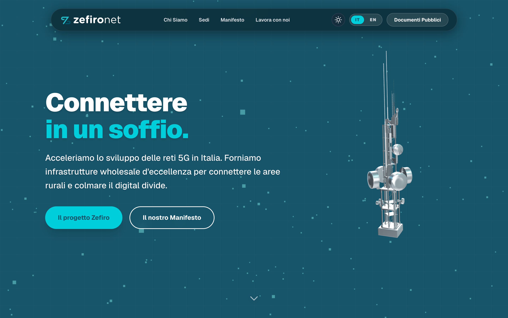
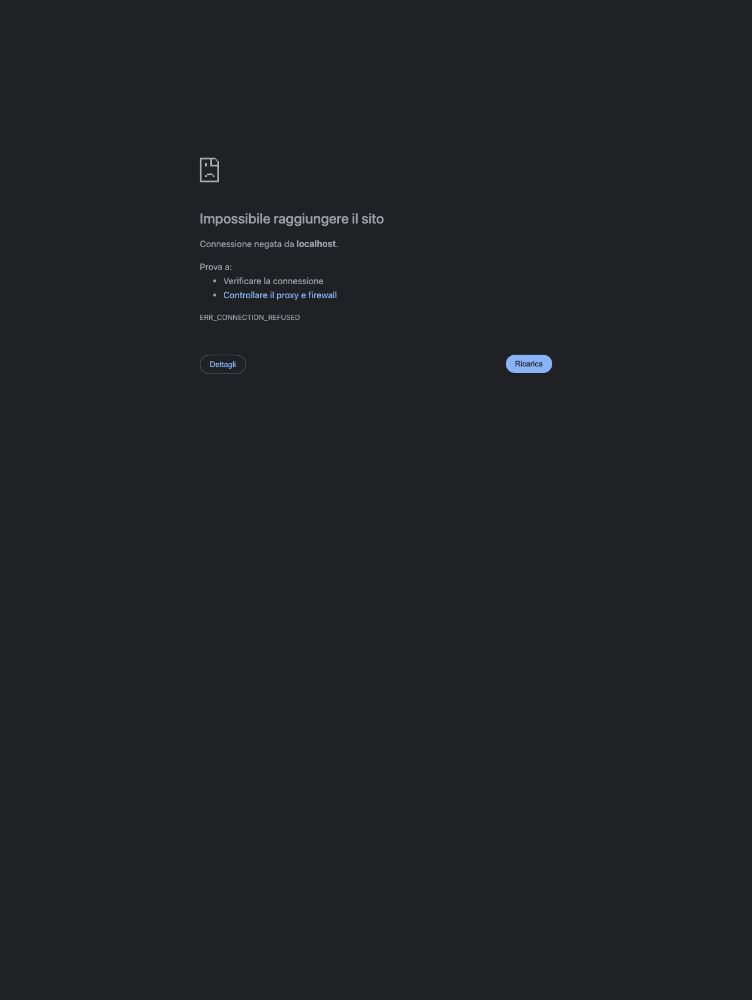
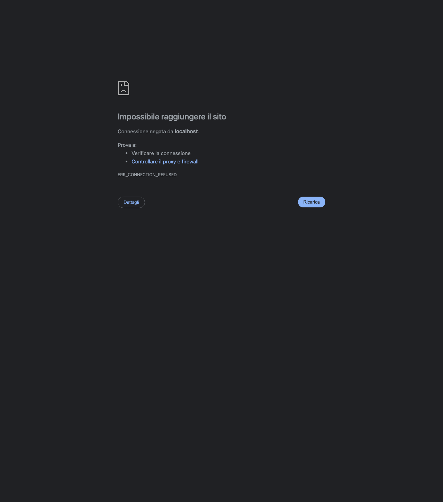
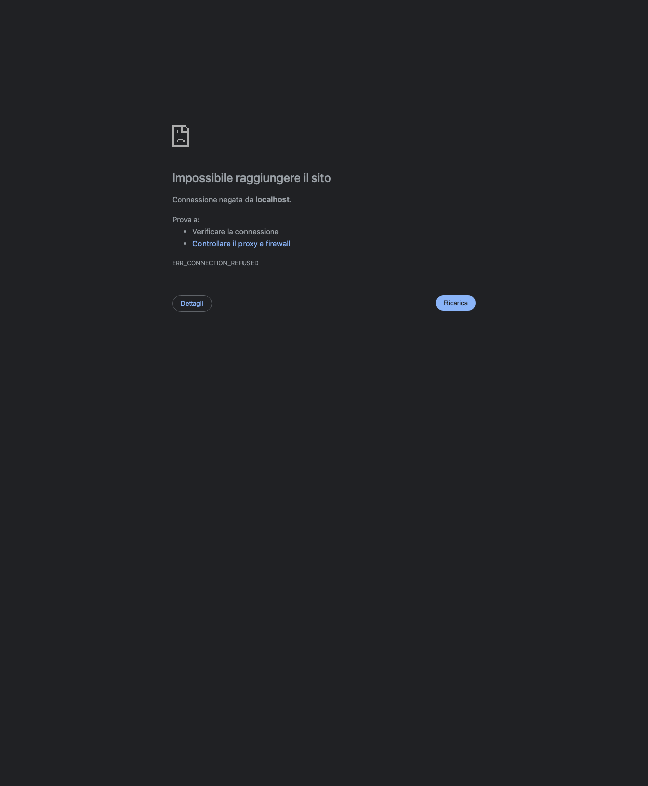
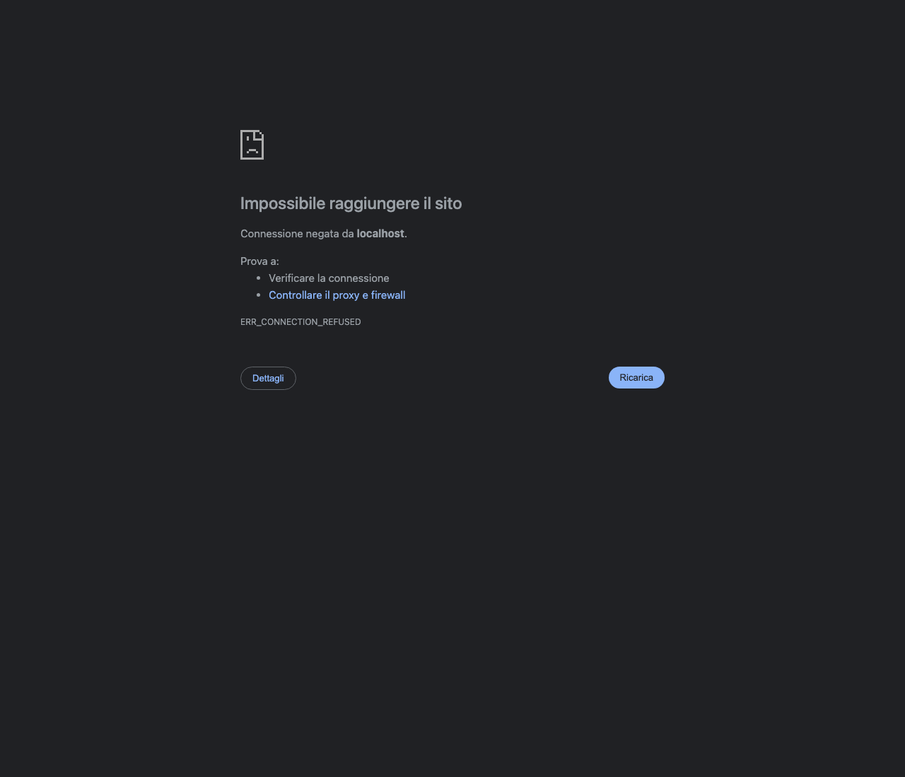
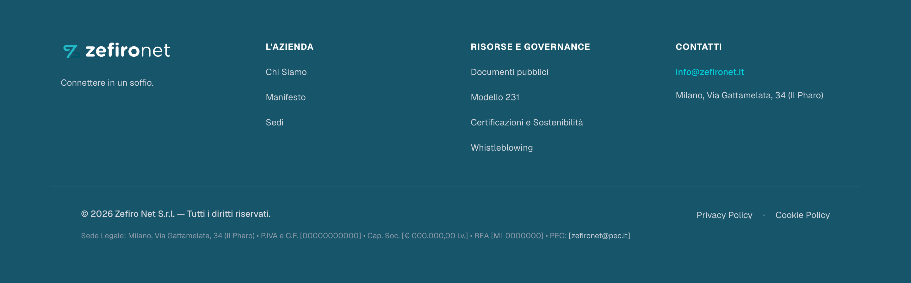

# 📄 Modulo Raccolta e Revisione Contenuti — Zefiro Net Website
> **Destinatario:** Team HR, Comunicazione & Direzione Zefiro Net S.r.l.  
> **Oggetto:** Inserimento, approvazione testi (Italiano 🇮🇹 / Inglese 🇬🇧), note di sezione e dati societari per il nuovo sito web istituzionale.  
> **Istruzioni:**  
> 1. Ciascuna sezione presenta il riferimento visivo e i campi da compilare `[ NUOVO TESTO IT ]` e `[ NUOVO TESTO EN ]`.  
> 2. Se un testo attuale è già approvato, è sufficiente scrivere **"CONFERMATO"**.  
> 3. Per ciascuna sezione è disponibile un campo **"📝 Note & Indicazioni Generali"** dove inserire commenti liberi, feedback di grafica o istruzioni speciali.  
> 4. Nella Sezione 9 sono indicati i dati societari da completare.

---

## 📌 Indice delle Sezioni
1. [Header & Menu di Navigazione](#1-header--menu-di-navigazione)
2. [Homepage (Hero Banner, Mappa di Copertura, Metriche, Highlights)](#2-homepage)
3. [Pagina: Chi Siamo (La Joint Venture, Missione, Wholesale, Soci, Certificazioni)](#3-pagina-chi-siamo)
4. [Pagina: Sedi (Milano & Roma)](#4-pagina-sedi)
5. [Pagina: Manifesto (I 5 Pilastri Guida)](#5-pagina-manifesto)
6. [Pagina: Lavora con Noi (Valori People, Candidatura Spontanea)](#6-pagina-lavora-con-noi)
7. [Pagina: Documenti Pubblici (Bilanci, Governance, Sicurezza)](#7-pagina-documenti-pubblici)
8. [Footer del Sito Web](#8-footer-del-sito-web)
9. [Dati Societari Obbligatori (Conformità Legale)](#9-dati-societari-obbligatori)

---

## 1. Header & Menu di Navigazione
*La barra di navigazione visibile in cima a tutte le pagine del sito.*

| Voce Menu | Testo Attuale (IT) | NUOVO TESTO IT (da compilare) | Testo Attuale (EN) | NUOVO TESTO EN (da compilare) |
| :--- | :--- | :--- | :--- | :--- |
| Voce 1 | Chi Siamo | | About Us | |
| Voce 2 | Sedi | | Offices | |
| Voce 3 | Manifesto | | Manifesto | |
| Voce 4 | Lavora con noi | | Work with us | |
| Voce 5 | Documenti Pubblici | | Public Documents | |

> 📝 **NOTE & INDICAZIONI GENERALI PER LA SEZIONE 1 (HEADER):**  
> `[ Inserire qui eventuali note, richieste o modifiche per il Menu di navigazione ]`

---

## 2. Homepage

### 2.1 Hero Banner Principale (A tutto schermo)
*Il primo impatto visivo del sito con l'antenna 3D interattiva.*

- **Titolo Principale (Claim):**
  - *Attuale IT:* `Connettere in un soffio.`
  - **[ NUOVO TESTO IT ]: **
  - *Attuale EN:* `Connecting in a breath.`
  - **[ NUOVO TESTO EN ]: **

- **Sottotitolo / Descrizione:**
  - *Attuale IT:* `Acceleriamo lo sviluppo delle reti 5G in Italia. Forniamo infrastrutture wholesale d'eccellenza per connettere le aree rurali e colmare il digital divide.`
  - **[ NUOVO TESTO IT ]: **
  - *Attuale EN:* `We accelerate the deployment of 5G networks across Italy. Providing world-class wholesale infrastructure to connect rural areas and bridge the digital divide.`
  - **[ NUOVO TESTO EN ]: **

- **Pulsante CTA Primario (Azzurro):**
  - *Attuale IT:* `Il progetto Zefiro` (porta a Chi Siamo)
  - **[ NUOVO TESTO IT ]: **
  - *Attuale EN:* `The Zefiro Project`
  - **[ NUOVO TESTO EN ]: **

- **Pulsante CTA Secondario (Trasparente con bordo bianco):**
  - *Attuale IT:* `Il nostro Manifesto` (porta a Manifesto)
  - **[ NUOVO TESTO IT ]: **
  - *Attuale EN:* `Our Manifesto`
  - **[ NUOVO TESTO EN ]: **

> 📝 **NOTE & INDICAZIONI GENERALI PER LA SEZIONE 2.1 (HERO BANNER):**  
> `[ Inserire qui eventuali note, commenti sulla grafica o richieste per la Hero Banner ]`

---

### 2.2 Sezione Mappa di Copertura & Metriche Chiave
*Sezione a schermo intero con mappa vettoriale dell'Italia e 3 statistiche.*

- **Badge:** `COPERTURA RADIOMOBILE NAZIONALE`
- **Titolo Sezione:**
  - *Attuale IT:* `Connettiamo il 70% del territorio italiano`
  - **[ NUOVO TESTO IT ]: **
  - *Attuale EN:* `Connecting 70% of Italian Territory`
  - **[ NUOVO TESTO EN ]: **

- **Paragrafo Descrittivo:**
  - *Attuale IT:* `Superiamo il digital divide portando la tecnologia 5G e le reti ultra-broadband nel 70% del territorio nazionale, principalmente nelle aree rurali e meno densamente popolate del Paese. Con circa 7.000 siti e torri radiomobili attive, abilitiamo un'infrastruttura wholesale d'eccellenza aperta e condivisa.`
  - **[ NUOVO TESTO IT ]: **
  - *Attuale EN:* `Bridging the digital divide by delivering 5G and ultra-broadband networks across 70% of the national territory, mainly in rural and sparsely populated areas. With around 7,000 active mobile sites and towers, we enable an open, shared wholesale infrastructure of excellence.`
  - **[ NUOVO TESTO EN ]: **

- **Statistica 1:**
  - *Valore:* `70%` | *Label IT:* `Territorio nazionale coperto (zone rurali)` | *Label EN:* `National territory covered (rural areas)`
  - **[ NUOVO TESTO IT ]: **
  - **[ NUOVO TESTO EN ]: **

- **Statistica 2:**
  - *Valore:* `~7.000` | *Label IT:* `Siti e torri radiomobili attive` | *Label EN:* `Active mobile towers & sites`
  - **[ NUOVO TESTO IT ]: **
  - **[ NUOVO TESTO EN ]: **

- **Statistica 3:**
  - *Valore:* `100%` | *Label IT:* `Wholesale-Only condiviso` | *Label EN:* `Shared Wholesale-Only`
  - **[ NUOVO TESTO IT ]: **
  - **[ NUOVO TESTO EN ]: **

> 📝 **NOTE & INDICAZIONI GENERALI PER LA SEZIONE 2.2 (MAPPA & STATISTICHE):**  
> `[ Inserire qui eventuali note sulle percentuali, numeri di torri o richieste sulla mappa ]`

---

### 2.3 Punti di Forza (Highlights)
*Le 3 schede con le caratteristiche tecnologiche di Zefiro Net.*

- **Scheda 1 (Copertura 5G):**
  - *Titolo IT:* `Copertura 5G Capillare` | *Testo IT:* `Infrastrutture radiomobili avanzate per abilitare la connettività ultra-broadband nelle aree rurali e a fallimento di mercato.`
  - **[ NUOVO TESTO IT ]: **
  - *Titolo EN:* `Widespread 5G Coverage` | *Testo EN:* `Advanced mobile infrastructure enabling ultra-broadband connectivity across rural and market-failure regions.`
  - **[ NUOVO TESTO EN ]: **

- **Scheda 2 (Modello Wholesale):**
  - *Titolo IT:* `Modello Wholesale Condiviso` | *Testo IT:* `Condivisione efficiente della rete di accesso tra operatori per ottimizzare gli investimenti e ridurre l'impatto ambientale.`
  - **[ NUOVO TESTO IT ]: **
  - *Titolo EN:* `Shared Wholesale Model` | *Testo EN:* `Efficient access network sharing between operators to optimize investments and minimize environmental impact.`
  - **[ NUOVO TESTO EN ]: **

- **Scheda 3 (Resilienza):**
  - *Titolo IT:* `Affidabilità e Resilienza` | *Testo IT:* `Controllo e monitoraggio continuativo 24/7 per garantire la massima continuità operativa e tempi di intervento immediati.`
  - **[ NUOVO TESTO IT ]: **
  - *Titolo EN:* `Reliability & Resilience` | *Testo EN:* `Continuous 24/7 monitoring and control to guarantee maximum operational continuity and rapid response times.`
  - **[ NUOVO TESTO EN ]: **

> 📝 **NOTE & INDICAZIONI GENERALI PER LA SEZIONE 2.3 (HIGHLIGHTS):**  
> `[ Inserire qui eventuali commenti o integrazioni sui punti di forza ]`

---

## 3. Pagina: Chi Siamo
*La pagina aziendale che descrive la joint venture, la missione, i soci e le certificazioni.*

- **Sottotitolo Principale:**
  - *Attuale IT:* `Zefiro Net SRL è la joint venture paritetica creata da WINDTRE e Iliad Italia, nata per gestire e sviluppare congiuntamente la rete di telefonia mobile nelle aree meno densamente popolate d'Italia.`
  - **[ NUOVO TESTO IT ]: **
  - *Attuale EN:* `Zefiro Net SRL is the 50/50 joint venture created by WINDTRE and Iliad Italia, established to jointly manage and expand mobile networks in Italy's less densely populated areas.`
  - **[ NUOVO TESTO EN ]: **

- **La Nostra Missione:**
  - *Attuale IT:* `La nostra missione è abbattere il digital divide, garantendo a tutto il territorio nazionale l'accesso a reti di telecomunicazione moderne e performanti. Attraverso la condivisione delle infrastrutture (RAN sharing), ottimizziamo gli investimenti e acceleriamo la copertura delle aree rurali e suburbane con le più recenti tecnologie, a partire dal 5G.`
  - **[ NUOVO TESTO IT ]: **
  - *Attuale EN:* `Our mission is to bridge the digital divide, ensuring equitable access to high-performance, modern telecommunications networks across the entire country. Through shared infrastructure (RAN sharing), we optimize capital investments and accelerate coverage in rural and suburban areas with state-of-the-art technologies, starting with 5G.`
  - **[ NUOVO TESTO EN ]: **

- **Modello Wholesale B2B:**
  - *Attuale IT:* `Zefiro Net opera esclusivamente come fornitore di infrastrutture all'ingrosso (wholesale) per i propri soci. Non forniamo servizi di connettività B2C diretti al pubblico, ma garantiamo che gli operatori partner possano offrire il miglior servizio possibile ai propri clienti, poggiandosi su un'infrastruttura resiliente, sicura e all'avanguardia tecnologica.`
  - **[ NUOVO TESTO IT ]: **
  - *Attuale EN:* `Zefiro Net operates exclusively as a wholesale infrastructure provider for its partners. We do not provide direct B2C consumer services; instead, we enable partner telecom operators to offer the highest quality service to their customers on a resilient, secure, and technologically advanced shared infrastructure.`
  - **[ NUOVO TESTO EN ]: **

- **I Soci (WINDTRE 50% & Iliad 50%):**
  - *WINDTRE IT:* `Socio al 50%, porta nella joint venture la solidità e la capillarità di uno dei principali operatori italiani.`
  - **[ NUOVO TESTO IT ]: **
  - *Iliad IT:* `Socio al 50%, contribuisce con la spinta innovativa che ha rivoluzionato il mercato mobile in Italia.`
  - **[ NUOVO TESTO IT ]: **

- **Certificazioni & Conformità:**
  - *Rating ESG, Modello 231, Certificazione ISO 9001*
  - **[ NUOVE CERTIFICAZIONI DA AGGIUNGERE ]: **

> 📝 **NOTE & INDICAZIONI GENERALI PER LA SEZIONE 3 (CHI SIAMO):**  
> `[ Inserire qui eventuali note sui soci, sulla governance o sulle certificazioni ]`

---

## 4. Pagina: Sedi
*Gli uffici direzionali e i poli operativi di Zefiro Net.*

- **Sede di Milano (Il Pharo - HQ):**
  - *Indirizzo:* `Via Gattamelata, 34 — 20149 Milano (MI)`
  - *Email:* `amministrazione@zefironet.it`
  - *Descrizione:* `Sede legale principale e centro direzionale e operativo di Zefiro Net.`
  - **[ NOTE O MODIFICHE ]: **

- **Sede di Roma (Polo Operativo):**
  - *Indirizzo:* `Via Luca Gaurico, 9/11 — 00143 Roma (RM)`
  - *Email:* `info@zefironet.it`
  - *Descrizione:* `Ufficio operativo e polo di coordinamento di Zefiro Net a Roma.`
  - **[ NOTE O MODIFICHE ]: **

> 📝 **NOTE & INDICAZIONI GENERALI PER LA SEZIONE 4 (SEDI):**  
> `[ Inserire qui eventuali recapiti telefonici, orari di apertura o note di accesso ]`

---

## 5. Pagina: Manifesto
*I 5 pilastri valoriali e guida strategica di Zefiro Net.*

- **Pilastro 01 — Inclusione Digitale:**
  - *Attuale IT:* `Le aree meno densamente popolate meritano le stesse opportunità dei grandi centri urbani. La nostra infrastruttura è la base su cui si costruisce l'inclusione digitale del Paese.`
  - **[ NUOVO TESTO IT ]: **

- **Pilastro 02 — Sostenibilità & Condivisione:**
  - *Attuale IT:* `Il modello della joint venture e del RAN sharing riduce l'impatto ambientale e paesaggistico. Costruiamo una rete unica per più operatori, ottimizzando risorse e limitando la proliferazione di antenne.`
  - **[ NUOVO TESTO IT ]: **

- **Pilastro 03 — Eccellenza B2B:**
  - *Attuale IT:* `Come operatore wholesale, la nostra responsabilità è verso i nostri soci e, indirettamente, verso i loro clienti. Garantiamo i massimi standard di affidabilità, sicurezza informativa e innovazione tecnologica.`
  - **[ NUOVO TESTO IT ]: **

- **Pilastro 04 — Innovazione Responsabile:**
  - *Attuale IT:* `Sperimentiamo tecnologie all'avanguardia come il 5G con l'obiettivo di migliorare la vita delle persone, rispettando sempre i più alti standard di sicurezza e privacy.`
  - **[ NUOVO TESTO IT ]: **

- **Pilastro 05 — Integrità & Trasparenza:**
  - *Attuale IT:* `Operiamo con la massima onestà e chiarezza nei confronti dei nostri soci, dei partner e della collettività, promuovendo una governance solida e affidabile.`
  - **[ NUOVO TESTO IT ]: **

> 📝 **NOTE & INDICAZIONI GENERALI PER LA SEZIONE 5 (MANIFESTO):**  
> `[ Inserire qui eventuali commenti o modifiche ai valori del Manifesto ]`

---

## 6. Pagina: Lavora con Noi
*La pagina di selezione, cultura People e carriere.*

- **I 3 Valori del Team (People):**
  - *1. Innovazione Continua*
  - *2. Sostenibilità*
  - *3. Eccellenza Tecnica*
  - **[ NOTE O MODIFICHE ]: **

- **Candidatura Spontanea:**
  - *Email Attuale:* `candidatura@zefironet.it`
  - *Istruzioni:* `Inviaci il tuo CV e raccontaci come puoi contribuire al progetto Zefiro Net.`
  - **[ CONFERMA O NUOVA EMAIL HR ]: **

- **Posizioni Aperte (Job Openings):**
  - `[ Inserire qui eventuali posizioni aperte da pubblicare online, specificando Titolo, Sede e Requisiti ]`

> 📝 **NOTE & INDICAZIONI GENERALI PER LA SEZIONE 6 (LAVORA CON NOI):**  
> `[ Inserire qui eventuali note del team HR sui processi di recruiting o privacy candidati ]`

---

## 7. Pagina: Documenti Pubblici
*Sezione documentale per il download dei PDF societari.*

| N° | Documento Richiesto | Categoria | Stato File PDF |
| :--- | :--- | :--- | :--- |
| 1 | Bilancio d'Esercizio 2024 | Finanza | `[ ] Da allegare: bilancio-2024.pdf` |
| 2 | Bilancio d'Esercizio 2023 | Finanza | `[ ] Da allegare: bilancio-2023.pdf` |
| 3 | Relazione sul Governo Societario | Governance | `[ ] Da allegare: governance-report.pdf` |
| 4 | Codice Etico e di Condotta | Governance | `[ ] Da allegare: codice-etico.pdf` |
| 5 | Politica Sicurezza Informazioni | Sicurezza | `[ ] Da allegare: sicurezza-info.pdf` |

> 📝 **NOTE & INDICAZIONI GENERALI PER LA SEZIONE 7 (DOCUMENTI):**  
> `[ Inserire qui eventuali note sui documenti, scadenze di pubblicazione o documenti aggiuntivi ]`

---

## 8. Footer del Sito Web
*Il piè di pagina presente su tutto il sito.*

- **Tagline:** `Connettere in un soffio.`
- **Link Colonne:** *Chi siamo, Manifesto, Sedi, Documenti pubblici, Modello 231, Certificazioni, Whistleblowing, Privacy Policy, Cookie Policy*

> 📝 **NOTE & INDICAZIONI GENERALI PER LA SEZIONE 8 (FOOTER):**  
> `[ Inserire qui note su link aggiuntivi o canali social ]`

---

## 9. Dati Societari Obbligatori
*Tabella dei dati legali obbligatori ai sensi dell'art. 2250 del Codice Civile.*

| Dato Richiesto | Segnaposto Attuale sul Sito | ✏️ DATO UFFICIALE (da compilare) |
| :--- | :--- | :--- |
| **Partita IVA & Codice Fiscale** | `[00000000000]` | |
| **Capitale Sociale Deliberato e Versato** | `[€ 000.000,00 i.v.]` | |
| **Numero REA Registro Imprese Milano** | `[MI-0000000]` | |
| **Indirizzo PEC Ufficiale** | `[zefironet@pec.it]` | |
| **Link Piattaforma Whistleblowing** | `https://zefironet.integrityline.com/` | |

> 📝 **NOTE & INDICAZIONI GENERALI PER LA SEZIONE 9 (DATI SOCIETARI & LEGALI):**  
> `[ Inserire qui note legali, iscrizioni ad albi o informazioni societarie speciali ]`
